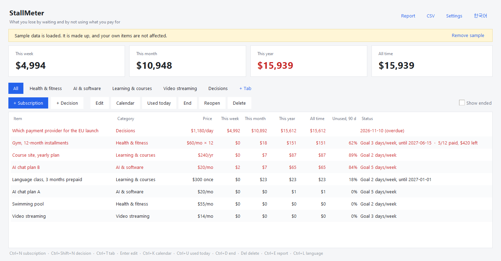
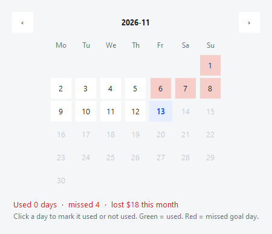

[English](README.md) | **한국어**

# StallMeter

돈 내고 안 쓰는 것과 미뤄 둔 결정 때문에 잃는 돈을 금액으로 보여 준다.



## 만든 이유

당장 부자가 되기는 어렵다. 덜 잃는 것은 오늘부터 할 수 있는데, 그 손실이 눈에 잘 안 보인다.
끊어 놓고 안 가는 헬스장, 거의 열지 않는 두 번째 AI 요금제, 팀이 몇 주째 기다리는 결정이 그렇다.
어느 것도 "낭비한 돈" 청구서를 보내지 않는다.
StallMeter는 이것들을 주·월·연 단위 금액으로 바꿔서, 무엇을 해지하고 무엇을 먼저 처리할지 판단할 근거를 준다.

## 기능

- **구독, 내는 방식 네 가지**: 매달 결제, 연간 일시불(매년 갱신), 기간 일시불, 할부(할부 개월 수 입력). 일주일에 며칠 쓸 생각인지(목표)를 정한다.
- **달력**: 쓴 날을 눌러 표시한다. 주간 목표를 못 채운 날은 빨간색이 되고 손실로 센다.
- **미결 사항**: 기다리는 인원 × 시간당 비용 × 하루에 잃는 시간을, 결정이 열려 있는 근무일마다 더한다.
- **직접 관리하는 탭**: "전체" 탭과 내가 만든 탭이 있다. 탭을 추가하고, 이름을 바꾸고, 삭제할 수 있다. 추천 이름 18개(영상 스트리밍, 음악, AI·소프트웨어, 클라우드 저장공간, 게임, 건강·운동, 쇼핑 멤버십 등)에서 고르거나 직접 적는다. 탭을 삭제해도 항목은 지우지 않고 "미분류"로 옮긴다.
- **기간별 손실**: 이번 주, 이번 달, 올해, 전체 기간을 열린 탭 기준 카드 네 개와 항목별 열로 보여 준다.
- **빈 화면으로 시작, 샘플로 체험**: "샘플 불러오기"를 누르면 내는 방식 네 가지를 모두 보여 주는 지어낸 항목이 들어온다. "샘플 지우기"로 다시 빼며, 직접 넣은 항목은 건드리지 않는다.
- **"90일 미사용"**: 최근 90일 요금 중 잃은 비율이다. 50% 이상이면 빨간색이 된다. 해지를 판단할 때 보는 숫자다.
- 보고서(Markdown)와 CSV 내보내기. 영어와 한국어. 통화 기호는 자유롭게 바꾼다.
- 포터블 exe 하나. 설치, 계정, 네트워크가 필요 없다. 데이터는 exe 옆 JSON 파일에만 있다.



## 설치

아직 공개 릴리스가 없다. 아래 방법으로 빌드한 뒤 `dist\StallMeter.exe`를 아무 곳에나 복사해서 실행한다.
exe에 코드 서명이 없어서 처음 실행할 때 Windows SmartScreen 경고가 뜰 수 있다. "추가 정보"를 누른 뒤 "실행"을 고른다.

## 소스에서 빌드

Windows 10/11과 [uv](https://docs.astral.sh/uv/)가 필요하다.

```bat
uv venv --python 3.14 .venv
uv pip install --python .venv\Scripts\python.exe pyinstaller
build.bat
```

`build.bat`은 단위 테스트를 돌리고, `dist\StallMeter.exe`를 만들고, 만든 exe를 한 번 실행해 스모크 테스트를 한다. 어느 단계든 실패하면 멈춘다.

## 사용법

1. `Ctrl+N`으로 구독을 추가한다. 이름, 탭, 내는 방식, 금액, 시작일, 일주일에 쓰려는 날 수를 넣는다. 먼저 둘러보려면 빈 화면에서 "샘플 불러오기"를 누른다.
2. 쓴 날에는 항목을 고르고 `Ctrl+U`를 누른다. 지난 날짜는 `Ctrl+K`로 달력을 열어 채운다.
3. 이번 주·이번 달·올해 열을 본다. "90일 미사용"이 계속 높으면 실제로 해지한 뒤 `Ctrl+D`로 앱에서도 종료한다.
4. 사람들이 기다리는 결정은 `Ctrl+Shift+N`으로 추가한다.

| 키 | 동작 |
|---|---|
| `Ctrl+N` | 새 구독 |
| `Ctrl+Shift+N` | 새 미결 사항 |
| `Ctrl+T` | 새 탭 |
| `Enter` / 더블클릭 | 수정 |
| `Ctrl+K` | 사용한 날 달력 |
| `Ctrl+U` | 오늘 사용함으로 표시 |
| `Ctrl+D` | 종료 (해지한 구독, 또는 결정됨) |
| `Del` | 삭제 |
| `Ctrl+E` | 현재 탭의 보고서 내보내기 |
| `Ctrl+L` | 언어 전환 |

사용한 날은 직접 입력한다. 앱이 다른 앱의 달력을 읽거나 사용량을 측정하지는 않는다.
숫자를 더하는 방법은 [doc/how-it-works.ko.md](doc/how-it-works.ko.md)에 있다.

## 프로젝트 구조

```
app.py        창 (Tkinter)
core.py       손실 계산, 저장, 내보내기 (GUI import 없음)
i18n.py       UI 문구 (en, ko)
test_core.py  단위 테스트
build.bat     테스트 -> 빌드 -> 스모크 테스트
tools/        smoke.ps1, make_sample.py
doc/          how-it-works, images
```

## 기여자

- 프로젝트 소유자가 방향을 정했다: 셀 수 있는 손실, 사용 달력이 있는 구독, 내는 방식 구분(월, 연간, 할부), 추가·삭제할 수 있는 탭, 주·월·연 합계, 빈 화면 시작과 샘플, 모던한 화면.
- Claude(Anthropic)가 첫 버전(미결 사항 미터)을 제안하고, 손실 규칙을 설계하고, 코드·테스트·문서를 작성하고, 빌드를 검증했다.

## 라이선스

[MIT](LICENSE). exe에 함께 들어가는 외부 구성 요소는 [THIRD-PARTY-NOTICES.md](THIRD-PARTY-NOTICES.md)에 있다.
