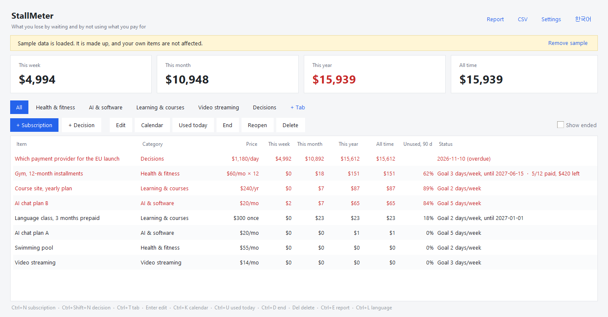
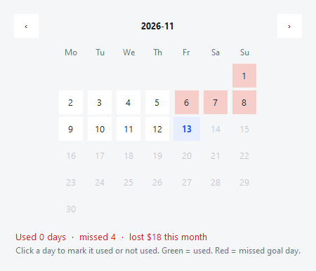

**English** | [한국어](README.ko.md)

# StallMeter

Shows, in money, what you lose by not using what you pay for and by putting decisions off.



## Why I made this

Getting rich quickly is hard. Losing less is something you can start today, but the loss is hard to see:
a gym membership you stopped going to, a second AI plan you rarely open, a decision a team has waited on for weeks.
None of these sends a bill for "money wasted".
StallMeter turns each one into a number per week, month and year, so you can tell what to cancel and what to settle first.

## Features

- **Subscriptions, four ways of paying**: every month; once a year with yearly renewal; once for a fixed term; or installments for a fixed term (you enter the number of installments). Set how many days a week you mean to use it.
- **Calendar**: click the days you used it. Days you missed against your weekly goal turn red and are counted as loss.
- **Decisions**: people waiting × hourly cost × hours lost per day, for every working day the decision stays open.
- **Tabs you manage**: an "All" tab plus your own tabs. Add, rename and remove them. 18 suggested names are offered (video streaming, music, AI & software, cloud storage, games, health & fitness, shopping memberships and more), or type your own. Removing a tab keeps its items and moves them to "Uncategorized".
- **Loss by period**: this week, this month, this year and all time, shown as four cards for the open tab and as columns per item.
- **Starts empty, with a sample to try**: "Load sample" adds made-up items that show every way of paying. "Remove sample" takes them out again and leaves your own items alone.
- **"Unused, 90 d"**: the share of the last 90 days' price that was lost. Items at 50% or more turn red. This is the number to look at before cancelling.
- Report (Markdown) and CSV export. English and Korean. Any currency symbol.
- One portable exe. No install, no account, no network. Data stays in a JSON file next to the exe.



## Install

There is no public release yet. Build it from source (below), then copy `dist\StallMeter.exe` anywhere and run it.
The exe is not code-signed, so Windows SmartScreen may warn on first run: choose "More info" and then "Run anyway".

## Build from source

Windows 10/11 with [uv](https://docs.astral.sh/uv/).

```bat
uv venv --python 3.14 .venv
uv pip install --python .venv\Scripts\python.exe pyinstaller
build.bat
```

`build.bat` runs the unit tests, builds `dist\StallMeter.exe`, and runs the built exe once as a smoke test. It stops if any step fails.

## Usage

1. Press `Ctrl+N` and add a subscription: name, tab, how you pay, amount, start date, and days per week you mean to use it. To look around first, press "Load sample" on the empty screen.
2. On a day you use it, select it and press `Ctrl+U`. To fill in past days, open the calendar with `Ctrl+K`.
3. Watch the week, month and year columns. When "Unused, 90 d" stays high, cancel the subscription, then press `Ctrl+D` to end it in the app.
4. For a decision people are waiting on, press `Ctrl+Shift+N`.

| Key | Action |
|---|---|
| `Ctrl+N` | New subscription |
| `Ctrl+Shift+N` | New decision |
| `Ctrl+T` | New tab |
| `Enter` / double-click | Edit |
| `Ctrl+K` | Calendar of use days |
| `Ctrl+U` | Mark today as used |
| `Ctrl+D` | End (cancelled subscription, or decided) |
| `Del` | Delete |
| `Ctrl+E` | Export report for the current tab |
| `Ctrl+L` | Switch language |

Use days are entered by hand. The app does not read other apps' calendars or measure your usage.
How the numbers are added up is in [doc/how-it-works.md](doc/how-it-works.md).

## Project layout

```
app.py        window (Tkinter)
core.py       loss maths, storage, export (no GUI imports)
i18n.py       UI text (en, ko)
test_core.py  unit tests
build.bat     tests -> build -> smoke test
tools/        smoke.ps1, make_sample.py
doc/          how-it-works, images
```

## Contributors

- The project owner set the direction: loss you can count, subscriptions with a use calendar, the ways of paying (monthly, yearly, installments), tabs you can add and remove, week / month / year totals, an empty start with a sample, and the modern look.
- Claude (Anthropic) proposed the first version (the decision meter), designed the loss rules, wrote the code, tests and documents, and verified the build.

## License

[MIT](LICENSE). Third-party parts bundled in the exe are listed in [THIRD-PARTY-NOTICES.md](THIRD-PARTY-NOTICES.md).
